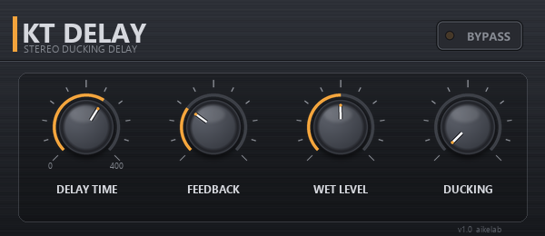

# KT Delay

シンプルなステレオ・ダッキングディレイ VST3 プラグイン（Windows 64bit）。

*KT Delay is a simple stereo ducking delay VST3 plug-in for Windows, written with the
Steinberg VST 3 SDK and VSTGUI (no JUCE). Documentation is in Japanese; see
[docs/DEVELOPMENT.md](docs/DEVELOPMENT.md) for build instructions.*



## 特徴

- ディレイ音を一切加工しないクリーンなディレイ（フィルタや劣化なし）
- **Ducking**: 原音が鳴っている間だけディレイ音を自動で下げ、原音が止まると戻ってくる
- ノブだけのシンプルな操作。Delay Time はノブを回している間だけ数値を表示
- 32 bit / 64 bit float 処理、ステレオ in / out
- パラメータ変更時にクリックノイズが出ないよう平滑化済み

## パラメータ

| パラメータ | 範囲 | 既定値 | 説明 |
|---|---|---|---|
| Delay Time | 0 – 400 ms | 250 ms | ディレイ時間 |
| Feedback | 0 – 100 % | 30 % | 繰り返しの量 |
| Wet Level | 0 – 100 % | 50 % | ディレイ音の音量（原音は常に 100 %） |
| Ducking | 0 – 100 % | 0 % | 原音が大きいときにディレイ音を下げる量。100 % で完全に消える |
| Bypass | on / off | off | バイパス |

Ducking は原音のレベルが -40 dBFS あたりから効き始め、-10 dBFS 以上で Ducking ノブで
指定した分だけディレイ音を下げます。原音が止まると約 0.2 秒かけてディレイ音が戻ります。

## 操作方法

- **ノブ**: 上下にドラッグ。Shift を押しながらで微調整、マウスホイールも使えます。
  ホストが「相対円形モード」を指定している場合はそれに従います。
- **Delay Time の数値表示**: ノブを回している間だけ表示され、離すと約 1 秒で消えます。
- **Bypass**: クリックで切り替え。ホストのバイパスとも連動します。

## インストール

1. [Releases](../../releases) から `KTDelay.vst3` をダウンロードします。
2. フォルダごと次の場所にコピーします。

   ```
   C:\Program Files\Common Files\VST3\KTDelay.vst3\
   ```

3. DAW でプラグインを再スキャンします。エフェクトの **Delay** カテゴリに
   「KT Delay」（ベンダー: aikelab）として表示されます。

## 動作環境

- Windows 10 / 11（64 bit）
- VST3 対応ホスト（Cubase、Studio One、Ableton Live、REAPER、FL Studio など）

## ソースからビルドする / 開発者向け情報

[docs/DEVELOPMENT.md](docs/DEVELOPMENT.md) を参照してください。
ビルド手順、SDK の配置、DSP テスト、GUI 画像の生成方法、ソース構成をまとめています。

## ライセンス

MIT License. Copyright (c) 2026 aike. 詳細は [LICENSE](LICENSE) を参照してください。

このプラグインは Steinberg VST 3 SDK（MIT License）と VSTGUI（BSD 3-Clause License）を
使用しています。SDK はこのリポジトリには含まれません。

VST is a trademark of Steinberg Media Technologies GmbH.
